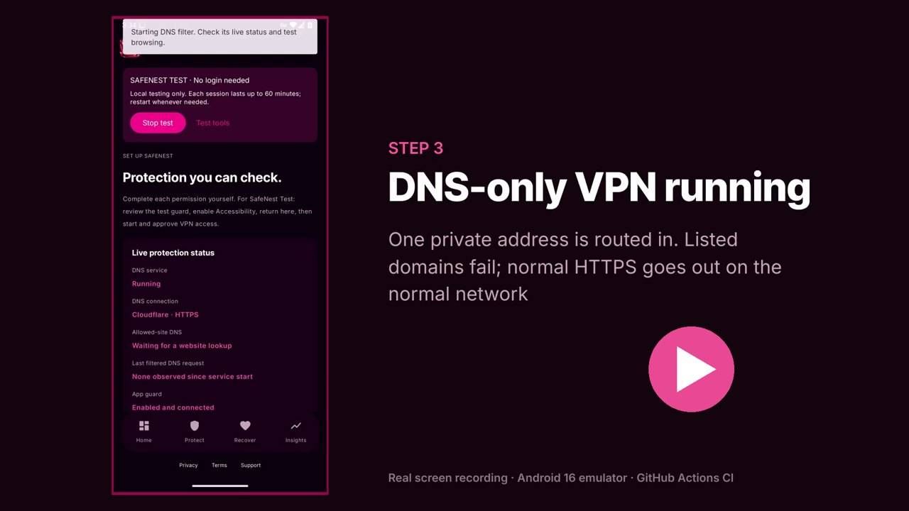
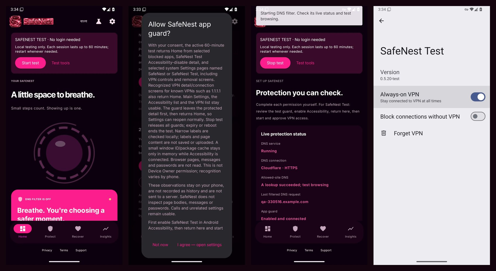
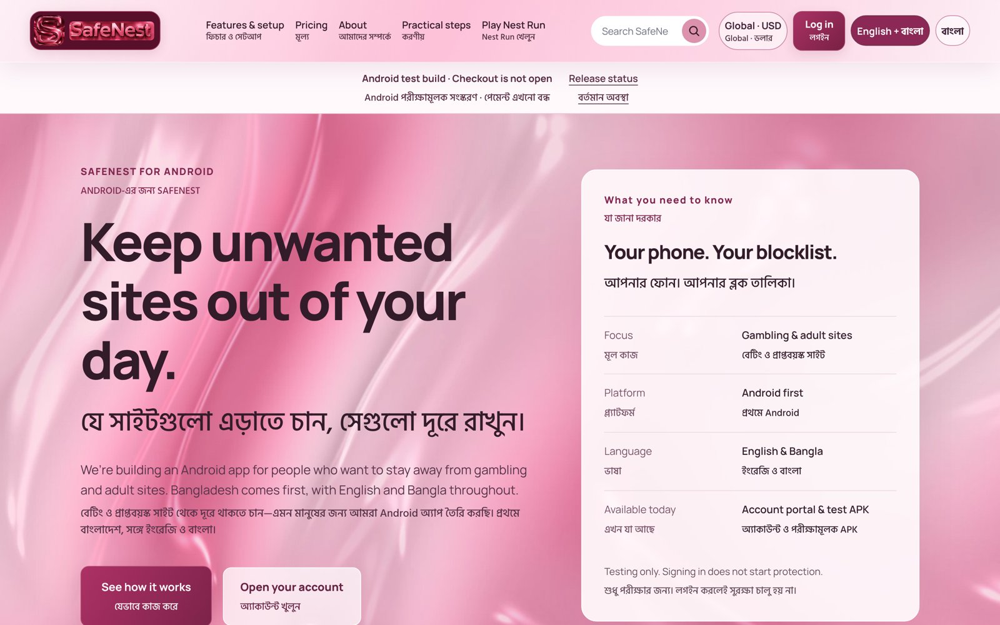
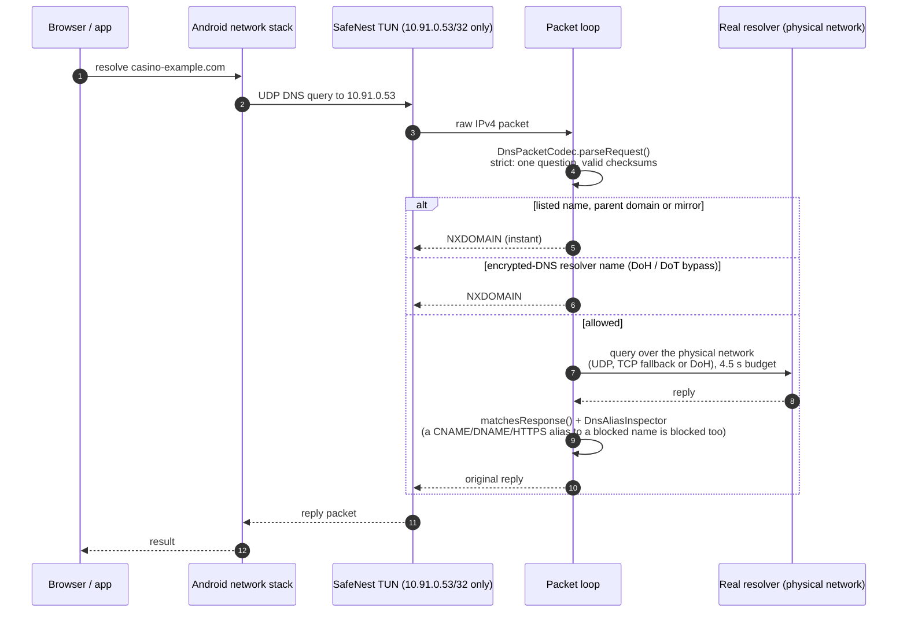
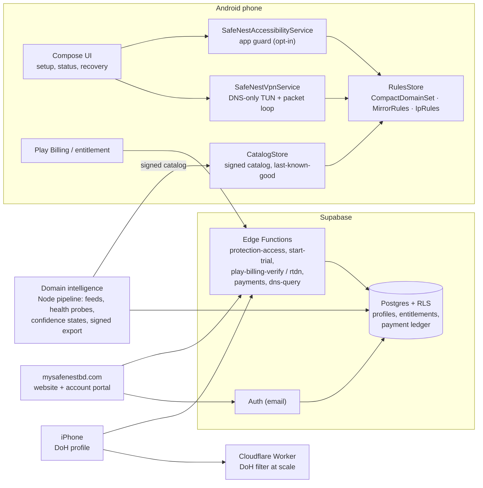

# SafeNest

**An Android app that helps people stop gambling by blocking gambling sites and apps on their own phone, privately and on-device.**

[](https://github.com/ShaonInTheCloud/ShaonInTheCloud/actions/workflows/safenest-ci.yml)


[Website](https://mysafenestbd.com) · [How it works](#how-the-dns-filter-works) · [Architecture](#architecture) · [Testing](#testing-and-ci) · [Build it](#build-and-run) · [Write-up: How I built a DNS-filtering VPN on Android](docs/blog-dns-filtering-vpn.md)

Online gambling is a fast-growing harm in Bangladesh, and the sites move to new domains every week. SafeNest is a self-exclusion tool: the user chooses to lock themselves out of gambling for a period they pay for, and the phone enforces that choice even on a bad day.

It works without root, without reading browsing history and without sending any of it to a server. Domain matching happens on the phone.

[](docs/media/SafeNest-demo.mp4)

*Watch the [53-second demo](docs/media/SafeNest-demo.mp4): a real screen recording of the app on an Android 16 emulator, made by the CI pipeline while its end-to-end test drives the setup, blocks gambling and VPN apps, and bounces the Uninstall button.*



<p align="center"></p>

## What it does

| Layer | What the user gets | How |
| --- | --- | --- |
| **Website filter** | 541,485 gambling domains and their subdomains stop resolving | A local DNS-only VPN answers listed names with NXDOMAIN |
| **New-mirror detection** | Brand-new mirror domains (`babu88a.com`, `jeetbuzz-bd.live`) are caught before any list has them | Brand + short-tail pattern rules |
| **Bypass resistance** | Browser "Secure DNS", other VPN apps and raw-IP links do not get around the filter | Encrypted-DNS resolver names refused; listed IP ranges routed into the tunnel and dropped; VPN apps sent Home |
| **App guard** | Gambling apps, and uninstalling SafeNest during the paid period, bounce to the home screen | Opt-in Accessibility service watching foreground package identity only |
| **Signed updates** | New domains arrive without an app update, and a tampered list is rejected | P-256 signed catalogs with a pinned key and monotonic revision |
| **iPhone** | The same blocklist on iOS | RFC 8484 DNS-over-HTTPS filter (Supabase Edge Function / Cloudflare Worker) + a configuration profile |

## How the DNS filter works

SafeNest does **not** tunnel the user's internet traffic. It claims a single private address as the DNS server and routes only that address into the VPN, so ordinary browsing stays on the normal network at full speed.



The important decisions:

- **DNS only, no default route.** `VpnService.Builder` adds the address `10.91.0.53/32` and nothing else, so the app never sees or slows down web traffic. Listed gambling IP ranges are added as extra routes; the loop only answers DNS, so packets to those ranges are dropped and sites opened by raw IP fail.
- **Blocked lookups never wait.** A blocked name is answered on the reader thread immediately; allowed names go to a bounded worker pool with a whole-request deadline, so a slow resolver cannot stall blocking.
- **Aliases are followed.** An allowed name whose answer is a CNAME, DNAME or SVCB/HTTPS alias to a blocked name is blocked as well (RFC 1035, 6672, 9460), with depth and loop limits.
- **Encrypted DNS is closed off.** Lookups for public DoH/DoT resolver hostnames and the Mozilla/Apple canary names get NXDOMAIN, which makes Firefox, Chrome and iCloud Private Relay fall back to system DNS.

## Architecture



The blocking engine on the phone is deliberately separate from the intelligence engine that discovers domains. The phone only ever receives a signed, versioned list; it never uploads what the user browses.

## Engineering highlights

- **Half a million domains in about 4 MB.** `CompactDomainSet` stores each hostname as a 64-bit FNV-1a + SplitMix64 fingerprint in a sorted array. Lookup is one binary search per label (`a.b.casino.com` checks four suffixes), and the file carries a SHA-256 of its payload so a truncated asset fails loudly. A `HashSet<String>` of the same data would be around 100 MB.
- **A paranoid DNS codec.** `DnsPacketCodec` accepts only complete, single-question IPv4/UDP queries addressed to the tunnel resolver, verifies checksums, rejects TSIG/SIG and fragments, and checks every upstream reply's transaction ID, question and record bounds before forwarding it.
- **Signed catalogs.** `CatalogVerifier` authenticates before it parses: canonical base64, a pinned ECDSA P-256 key, a strictly increasing revision and an expiry window. `CatalogStore` swaps state atomically and keeps the last verified list if an update fails.
- **Mirror detection.** Gambling brands register new domains weekly. `MirrorRules` treats `brand + short tail` (and a short lead such as `bd-` or `my-`) on common mirror TLDs as that brand, with an exclusion list for ordinary words.
- **Honest guard.** The Accessibility guard checks foreground package identity only. It never reads page content, never clicks permission dialogs, and leaves Settings usable; only the destructive action (Uninstall, Force stop, turning Always-on VPN off) sends the user Home during a paid period.
- **Defence in depth on the backend.** Row-level security on every user table, tested against an embedded Postgres (PGlite) with simulated `auth.uid()`: anonymous denial, cross-user denial, owner-only writes, immutable ownership.

## Testing and CI

Every push runs the full pipeline in GitHub Actions ([workflow](../.github/workflows/safenest-ci.yml)):

| Stage | What runs |
| --- | --- |
| Web + security | 138 Node tests: RLS isolation on embedded Postgres, payment webhooks and ledger, Play Billing verification, DoH filter wire format, security headers |
| Android unit tests | 32 JVM test classes (about 550 assertions) across the Play, Direct and Lab flavors: DNS codec, alias inspector, domain rules, compact set, catalog verifier, mirror rules, bypass names |
| Lint + build | Android lint for three flavors, debug APKs and an unsigned Play release bundle |
| **Emulator end-to-end** | Boots an Android 16 emulator, installs the app plus stand-in gambling, VPN and VPN-browser apps, and drives the real setup with UI Automator. **26 device checks**: a listed domain fails and ordinary HTTPS still works; Always-on VPN is switched on through Android's own UI; Uninstall, Force stop and Clear storage bounce Home while the rest of Settings stays usable; gambling and VPN apps bounce Home while an ordinary app stays open; everything is released when the test ends |

The emulator run uploads its screenshots and UI dumps as an artifact, so every failure can be diagnosed from the exact screen it happened on. Running the workflow by hand with **record_demo** also records the emulator screen; the demo video above came from that.

## Tech stack

| Area | Tools |
| --- | --- |
| Android | Kotlin, Java, Jetpack Compose, `VpnService`, `AccessibilityService`, Device Policy, Google Play Billing, Gradle 8.13, API 36 |
| Backend | Supabase (Auth, Postgres with RLS, Edge Functions in TypeScript/Deno), custom SMTP for auth email |
| DNS at the edge | RFC 8484 DoH filter as a Supabase Edge Function and a Cloudflare Worker |
| Intelligence pipeline | Node.js: feed ingestion, normalization and dedup, health probes, confidence states, signed export |
| Web | Vanilla JS website and account portal on Cloudflare, bilingual English/Bangla |
| Mobile (iOS track) | Expo / React Native client, `.mobileconfig` DNS profile |
| Quality | JUnit, UI Automator, Node test runner, PGlite, Python unittest, GitHub Actions |

## Repository layout

```
safenest/
├── android/          Android app (play, direct and lab flavors) and stand-in test apps
├── supabase/         Postgres migrations and Edge Functions
├── intelligence/     Domain intelligence pipeline and admin tools
├── cloudflare/       DoH Worker and DNS config
├── website/          mysafenestbd.com (Bangladesh and Global editions)
├── web/              Account portal source
├── mobile/           Expo client
├── data/             Blocklist sources and exclusions
├── tests/            Backend and web tests
└── docs/             Design notes, verification reports, launch checklist
```

## Build and run

Requirements: JDK 17 or 21, Android SDK 36, Node.js 22+.

```sh
cd safenest

# Website, account portal and backend tests
npm ci
npm test

# Core network rules and signature checks
sh run-core-tests.sh

# Android unit tests and a test build that needs no login
cd android
./gradlew :app:testLabDebugUnitTest :app:assembleLabDebug
# APK: app/build/outputs/apk/lab/debug/app-lab-debug.apk
```

Full Android instructions, including Windows and Android Studio, are in [BUILDING.md](BUILDING.md).

## Limits, stated plainly

SafeNest raises the cost of relapse a great deal; it is not an unbreakable wall, and the app says so to its users. A browser or app that talks to a resolver by raw IP, an HTTPS proxy, or a factory reset can get around it. The design goal is that every bypass takes deliberate effort, which is usually enough to get someone through the urge.

## Author

Built by **Md Humaun Kabir**, ICT engineering student at JAMK University of Applied Sciences, Jyväskylä, Finland.
[LinkedIn](https://www.linkedin.com/in/md-humaun-kabir-590976236/) · kabirmdhumaun23@gmail.com

Setup history for the account portal is in [docs/account-integration.md](docs/account-integration.md); the launch tracker is [docs/market-launch-checklist.md](docs/market-launch-checklist.md).
